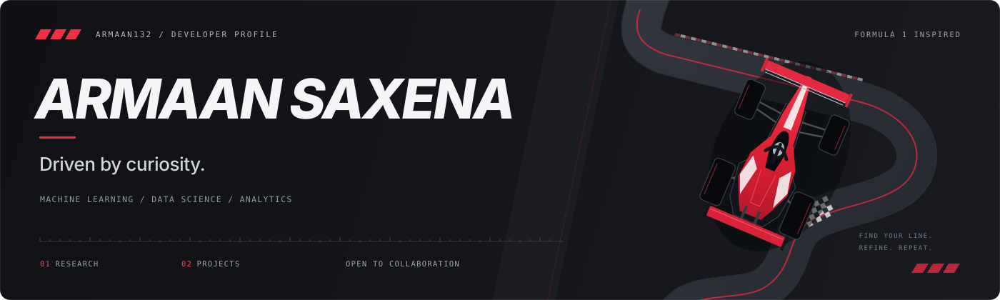

  

  <a href="https://www.linkedin.com/in/armaan-saxena28"><strong>LinkedIn</strong></a>
  &nbsp;&nbsp;·&nbsp;&nbsp;
  <a href="mailto:armaans1712@gmail.com"><strong>Email</strong></a>
  &nbsp;&nbsp;·&nbsp;&nbsp;
  <a href="https://github.com/armaan132"><strong>GitHub</strong></a>

I'm Armaan. My work spans **machine learning, data science, and analytics**, with projects across climate research, statistical learning, and software development.

**Open to collaboration on development projects.** [Get in touch.](mailto:armaans1712@gmail.com)

## Research

### [WD50 Research](https://github.com/armaan132/WD50-research)

Currently private

*“When It Rains, It Pours: How California's Extreme Weather Is Reshaping Water Supply Forever”*

Investigates how California's rainfall is concentrated into a small number of wet days, combining historical PRISM precipitation records with LOCA2 climate projections. The resulting manuscript has been submitted to **Scientific Reports**, a Nature Portfolio journal, for review.

### [Alzheimer's Research — UC Irvine (ICS)](https://docs.google.com/presentation/d/10q8vr073xSu2DW_WoiWPw-wqvLjlxP5e5YN-VaI47ms/edit?usp=sharing)

Currently public

A collaborative research study at the **University of California, Irvine (ICS)** assessing the relationship between everyday behavioral difficulties and cognitive impairment. Evaluates multinomial regression, LASSO, and decision trees as potential approaches to preliminary Alzheimer's screening.

## Projects

### [RFP Document Analysis System](https://github.com/RadheshAcumen/rfp-presales-system)

Currently private

A document analysis system designed to support the review of requests for proposals within presales workflows. Project ownership transferred from me to the team lead in **May 2026**.

### [Sign Language Web Application](https://github.com/armaan132/Sign-Language-Web-Application)

Currently private

An AI-assisted accessibility prototype that prepares document and text content for sign-language video generation. Integrates language simplification, translation, gloss generation, and human review with a modular avatar-rendering layer currently supported by mock output.

### [Stock Market Prediction Engine](https://github.com/armaan132/Stock-Market-Opportunity-Prediction-Engine/tree/main)

Currently private

An educational machine learning platform that estimates a company's probability of outperforming the S&P 500 over a 12-month horizon using financial fundamentals. Integrates data ingestion, feature engineering, time-based validation, and an interactive Streamlit dashboard for examining company rankings and model drivers.

### [Original Substack Project](https://github.com/alexhkurz/substack-pAIa)

Currently private

A Python research prototype exploring newsletter discovery, offline reading, and citation sentiment analysis across Substack content. Provides the foundation for the **Daily Briefing pAIa** browser extension.

### [Substack AI Extension](https://github.com/armaan132/substack-pAIa-extension)

Currently private

Adapted from the original Substack project, **Daily Briefing pAIa** is a Chrome extension that personalizes feeds using reading feedback, publication and author affinity, and content freshness. Provides transparent, rule-based rankings and stores user preferences locally in the browser.

### [CS Honors Project](https://github.com/CS196Illinois/FA24-Group17)

Currently public

A collaborative computer science honors project applying convolutional neural networks to character recognition. Implements image preprocessing, model training, and inference workflows with TensorFlow and Keras.

Private repositories require access to view.

---

  <strong>Let's build something useful.</strong> 
  <a href="mailto:armaans1712@gmail.com">armaans1712@gmail.com</a>
  &nbsp;·&nbsp;
  <a href="https://www.linkedin.com/in/armaan-saxena28">Connect on LinkedIn</a>

