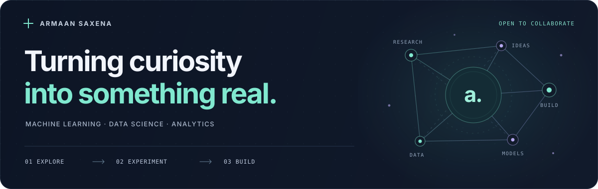

  

  <a href="https://www.linkedin.com/in/armaan-saxena28"><strong>LinkedIn</strong></a>
  &nbsp;&nbsp;·&nbsp;&nbsp;
  <a href="mailto:armaans1712@gmail.com"><strong>Email</strong></a>
  &nbsp;&nbsp;·&nbsp;&nbsp;
  <a href="https://github.com/armaan132"><strong>GitHub</strong></a>

## Hi, I'm Armaan

I'm interested in **machine learning, data science, analytics**, and the ideas that connect them. My projects span research, AI applications, and collaborative development, and I'm always curious about what to build next.

**Open to collaborating on development projects.** Have an idea? [Let's connect.](mailto:armaans1712@gmail.com)

---

## Research & exploration

### [WD50 Research](https://github.com/armaan132/WD50-research)

Private repository · Manuscript submitted for review

**“When It Rains, It Pours: How California's Extreme Weather Is Reshaping Water Supply Forever”**

Studies how California's rainfall is concentrated into fewer wet days using PRISM precipitation data and LOCA2 climate projections. The manuscript has been submitted to **Scientific Reports**, a Nature Portfolio journal, for review.

### [Alzheimer's Research — UC Irvine (ICS)](https://docs.google.com/presentation/d/10q8vr073xSu2DW_WoiWPw-wqvLjlxP5e5YN-VaI47ms/edit?usp=sharing)

Collaborative research at the **University of California, Irvine (ICS)** examining whether everyday behavioral difficulties can indicate the severity of cognitive impairment. Explores multinomial regression, LASSO, and decision trees as approaches to an initial Alzheimer's screening step.

## Projects & builds

### [RFP Document Analysis System](https://github.com/RadheshAcumen/rfp-presales-system)

Private repository

A document analysis system for working with requests for proposals in a presales workflow. Ownership transferred from me to the team lead in **May 2026**.

### [Sign Language Web Application](https://github.com/armaan132/Sign-Language-Web-Application)

Private repository

An AI-assisted prototype for turning documents and text into a sign-language video workflow. Combines language processing, sign-language gloss generation, and human review with a separate avatar-rendering layer that currently uses mock output.

### [Stock Market Prediction Engine](https://github.com/armaan132/Stock-Market-Opportunity-Prediction-Engine/tree/main)

An educational machine learning pipeline that uses company fundamentals to estimate the probability of outperforming the S&P 500 over the next 12 months. Includes financial data ingestion, feature engineering, time-based validation, and a Streamlit dashboard for exploring company rankings and model drivers.

### [Original Substack Project](https://github.com/alexhkurz/substack-pAIa)

Private repository

A Python research prototype for Substack newsletter discovery, offline reading, and citation sentiment analysis. This project formed the foundation for the browser extension below.

### [Substack AI Extension](https://github.com/armaan132/substack-pAIa-extension)

Private repository

Adapted from the original Substack project into **Daily Briefing pAIa**, a Chrome extension that personalizes feeds using reading feedback, author and publication affinity, and freshness. Uses transparent ranking rules and stores preferences locally in the browser.

### [CS Honors Project](https://github.com/CS196Illinois/FA24-Group17)

Public repository

A collaborative CS honors project implementing a convolutional neural network for character recognition with TensorFlow and Keras. Includes image preprocessing, model training, and prediction workflows.

Repositories marked private require access to view.

---

  <strong>Let's build something useful.</strong> 
  <a href="mailto:armaans1712@gmail.com">armaans1712@gmail.com</a>
  &nbsp;·&nbsp;
  <a href="https://www.linkedin.com/in/armaan-saxena28">Connect on LinkedIn</a>

